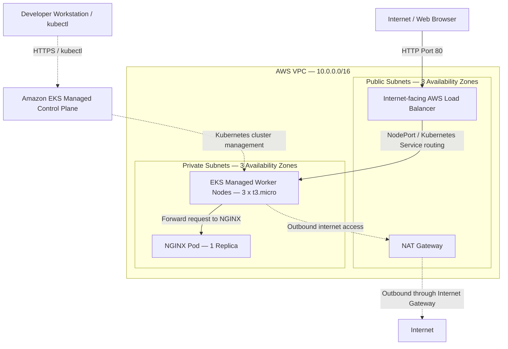
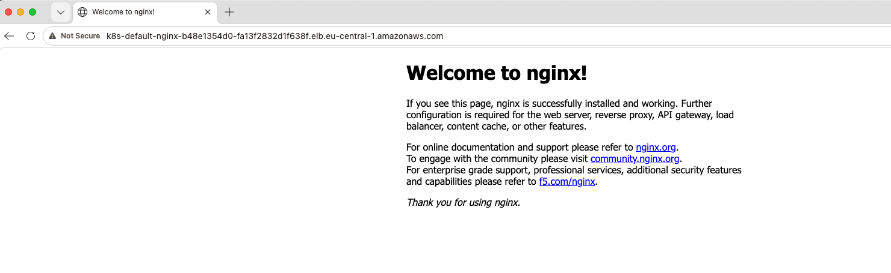

# AWS EKS with Terraform — Kubernetes NGINX Deployment

## Project Overview

This project demonstrates the provisioning of an Amazon Elastic Kubernetes Service (EKS) cluster using Terraform, followed by the deployment of a containerized NGINX web application using Kubernetes.

The AWS infrastructure includes a custom VPC, public and private subnets, a NAT Gateway, and an EKS managed node group. The NGINX application is deployed using Kubernetes manifests and exposed to the internet through an AWS Load Balancer.

The project demonstrates hands-on experience with Infrastructure as Code (IaC), AWS cloud networking, Kubernetes orchestration, application deployment, load balancing, and infrastructure lifecycle management.

The deployment was successfully tested, with three healthy Kubernetes worker nodes, a running NGINX Pod, and the NGINX welcome page accessible externally through the AWS Load Balancer.

## Key Achievements

- Provisioned an Amazon EKS cluster and supporting AWS infrastructure using Terraform.
- Configured a custom VPC with public and private subnets across three Availability Zones.
- Configured a NAT Gateway to provide outbound internet connectivity for private subnet resources.
- Deployed an EKS managed node group consisting of three EC2 worker nodes.
- Configured essential EKS add-ons, including CoreDNS, kube-proxy, VPC CNI, and EKS Pod Identity Agent.
- Deployed a containerized NGINX application using a Kubernetes Deployment.
- Exposed the application externally using a Kubernetes `LoadBalancer` Service.
- Successfully verified Kubernetes node readiness, Pod health, Deployment rollout, and external application accessibility.
- Practiced infrastructure validation, Kubernetes troubleshooting, and AWS resource lifecycle management.

---

## Architecture

The infrastructure is provisioned in the AWS Frankfurt region (`eu-central-1`) using Terraform. Amazon EKS provides the managed Kubernetes control plane, while EC2 worker nodes run application workloads inside private subnets.

The application is publicly accessible through an AWS Load Balancer, while the Kubernetes API endpoint allows cluster administration from a local workstation.



### How the Architecture Works

**1. Infrastructure Provisioning**

Terraform provisions the AWS networking infrastructure and EKS cluster using the official Terraform AWS VPC and EKS modules.

The VPC contains three public and three private subnets across three Availability Zones. Public subnets provide internet-facing connectivity for the AWS Load Balancer, while the private subnets host the EKS worker nodes.

**2. Amazon EKS Cluster**

Amazon EKS manages the Kubernetes control plane, while an EKS managed node group provides three `t3.micro` EC2 instances running Amazon Linux 2023.

The Kubernetes API endpoint is publicly accessible for cluster administration from the developer's workstation. This management endpoint is separate from the application Load Balancer.

**3. Kubernetes Application Deployment**

The `nginx-config.yaml` manifest defines two Kubernetes resources:

- Deployment: Creates and manages one NGINX Pod using the `nginx:1.30.6` container image.
- Service: Exposes the application through an AWS Load Balancer using HTTP on port 80.


**4. Application Traffic Flow**

When a user accesses the application through the AWS Load Balancer DNS name:

- Browser: Sends an HTTP request to the AWS Load Balancer on port 80.
- AWS Load Balancer: Forwards the request to a Kubernetes worker node through the Service's assigned NodePort.
- Kubernetes Service: Routes the request to the NGINX Pod.
- NGINX Pod: Processes the request and returns the welcome page to the browser.

The Kubernetes Service is a logical networking resource that routes traffic to application Pods, not a separate physical server.


**5. Outbound Connectivity**

The NAT Gateway enables resources in the private subnets to initiate outbound internet connections, such as downloading container images.

It is not part of the incoming HTTP traffic path used to access NGINX.

---

## Technology Stack

| Technology | Purpose / Configuration |
|---|---|
| Amazon Web Services (AWS) | Cloud infrastructure |
| Terraform | Infrastructure provisioning and management |
| Terraform AWS Provider | `~> 6.0` |
| Terraform EKS Module | `21.29.0` |
| Terraform VPC Module | `6.7.3` |
| Amazon EKS | Managed Kubernetes cluster |
| Kubernetes | Version `1.36` |
| Amazon EC2 | `t3.micro` managed worker nodes |
| Amazon Linux | `AL2023_x86_64_STANDARD` |
| Amazon VPC | Public/private subnets and routing |
| NAT Gateway | Outbound connectivity for private subnets |
| AWS Load Balancer | External application access |
| NGINX | Containerized web application (`1.30.6`) |
| YAML | Kubernetes resource configuration |

## AWS Infrastructure Configuration

### VPC and Networking

The project uses the Terraform AWS VPC module to provision the networking infrastructure.

| Resource | Configuration |
|---|---|
| AWS Region | `eu-central-1` (Frankfurt) |
| VPC Name | `myapp-vpc` |
| VPC CIDR | `10.0.0.0/16` |
| Private Subnet 1 | `10.0.1.0/24` |
| Private Subnet 2 | `10.0.2.0/24` |
| Private Subnet 3 | `10.0.3.0/24` |
| Public Subnet 1 | `10.0.4.0/24` |
| Public Subnet 2 | `10.0.5.0/24` |
| Public Subnet 3 | `10.0.6.0/24` |
| NAT Gateway | Enabled |
| NAT Configuration | Single NAT Gateway |
| DNS Hostnames | Enabled |

The public and private subnets include Kubernetes-specific tags that support AWS Load Balancer subnet discovery.

### EKS Cluster Configuration

| Setting | Configuration |
|---|---|
| Cluster Name | `myapp-eks-cluster` |
| Kubernetes Version | `1.36` |
| Node Group | `dev` |
| Instance Type | `t3.micro` |
| AMI Type | `AL2023_x86_64_STANDARD` |
| Desired Nodes | 3 |
| Minimum Nodes | 1 |
| Maximum Nodes | 3 |
| Worker Node Subnets | Private |
| Kubernetes API Endpoint | Public access enabled |

The cluster includes the following EKS add-ons:

- CoreDNS
- kube-proxy
- VPC CNI
- EKS Pod Identity Agent

The VPC CNI and EKS Pod Identity Agent are configured with `before_compute = true` in the Terraform EKS module.

---

## Project Structure

```text
terraform-aws-eks-kubernetes-nginx/
├── eks-cluster.tf
├── vpc.tf
├── providers.tf
├── nginx-config.yaml
├── terraform.tfvars.example
├── .terraform.lock.hcl
├── .gitignore
├── pictures/
│   └── nginx-welcome.png
└── README.md
```

### File Descriptions

| File | Description |
|---|---|
| `eks-cluster.tf` | EKS cluster, managed node group, and add-ons |
| `vpc.tf` | AWS VPC, public/private subnets, NAT Gateway, and networking tags |
| `providers.tf` | Terraform provider configuration |
| `nginx-config.yaml` | Kubernetes Deployment and LoadBalancer Service |
| `terraform.tfvars.example` | Example VPC and subnet configuration |
| `.terraform.lock.hcl` | Locked Terraform provider versions and checksums |
| `.gitignore` | Prevents local Terraform state and private files from being committed |
| `pictures/` | Project deployment screenshots |
| `README.md` | Project documentation |

Sensitive or machine-specific files, including Terraform state files, the local `terraform.tfvars`, and downloaded providers, are excluded from version control.

---

## Prerequisites

Before deploying the project, ensure the following tools and requirements are available:

- An AWS account with the necessary IAM permissions
- Terraform installed locally
- AWS CLI v2 installed and configured
- `kubectl` installed with a version compatible with the EKS cluster
- Git installed locally

Note: Provisioning EKS, EC2 instances, NAT Gateways, and AWS Load Balancers can incur charges. Destroy the infrastructure when it is no longer needed.

---

## Deployment Guide

### Step 1: Clone the Repository

```bash
git clone https://github.com/Johnpaul790/terraform-aws-eks-kubernetes-nginx.git

cd terraform-aws-eks-kubernetes-nginx
```

Create a local Terraform variables file using the provided example:

```bash
cp terraform.tfvars.example terraform.tfvars
```

Review the VPC and subnet values before deploying.

Verify your AWS credentials:

```bash
aws sts get-caller-identity
```

### Step 2: Provision AWS Infrastructure with Terraform

Initialize Terraform:

```bash
terraform init
```

Check Terraform formatting:

```bash
terraform fmt -check -recursive
```

Validate the Terraform configuration:

```bash
terraform validate
```

Review the infrastructure changes:

```bash
terraform plan
```

Provision the infrastructure:

```bash
terraform apply
```

Review the proposed changes before confirming the deployment.

Terraform creates the configured VPC networking resources, EKS cluster, and managed worker nodes.

### Step 3: Configure Kubernetes Access

After the EKS cluster has been created, update the local Kubernetes configuration:

```bash
aws eks update-kubeconfig \
  --region eu-central-1 \
  --name myapp-eks-cluster
```

Verify connectivity to the cluster:

```bash
kubectl get nodes
```

The worker nodes should report `Ready` when they have successfully joined the cluster.

### Step 4: Deploy NGINX to Kubernetes

Apply the Kubernetes manifest:

```bash
kubectl apply -f nginx-config.yaml
```

Check the NGINX Pod:

```bash
kubectl get pods 
```

Verify the Deployment rollout:

```bash
kubectl rollout status -n default deployment/nginx
```

Check the Kubernetes Service:

```bash
kubectl get svc nginx
```

The Service should display an AWS Load Balancer DNS hostname once the Load Balancer has been provisioned.

### Step 5: Access the NGINX Application

Open the hostname in your browser using:

```text
http://<load-balancer-dns-name>
```

The application is exposed through HTTP on port 80. HTTPS is not configured for this demonstration.

When the Load Balancer and backend connections are ready, the default NGINX welcome page should appear.

---

## Deployment Verification

The application was successfully deployed and tested on Amazon EKS.

The following results were observed during the lab deployment:

| Verification | Result |
|---|---|
| EKS Worker Nodes | 3 nodes in `Ready` status |
| NGINX Pod | `1/1 Running` |
| Container Restarts | 0 at the time of verification |
| Kubernetes Deployment | Successfully rolled out |
| Kubernetes Service | `LoadBalancer` |
| External DNS | AWS Load Balancer hostname assigned |
| Browser Accessibility | NGINX welcome page successfully displayed over HTTP |

The deployment was verified using Kubernetes commands and direct browser access through the AWS Load Balancer.

### NGINX Application Screenshot



*Successful NGINX deployment accessed through the AWS Load Balancer. The endpoint is temporary and may change when the infrastructure is recreated.*

---

## Design Decisions

The project was built as a personal Cloud/DevOps learning environment, with the following architectural choices:

**Public EKS API Endpoint**

Public API access was enabled to allow Kubernetes cluster administration from a local MacBook using `kubectl`. Access still requires appropriate AWS authentication and Kubernetes authorization.

**Private Worker Nodes**

The EKS worker nodes are deployed in private subnets to separate application compute resources from direct public internet exposure.

**Single NAT Gateway**

A single NAT Gateway was selected to reduce infrastructure costs for a home lab, rather than deploying a NAT Gateway in each Availability Zone.

**EC2 Instance Type**

`t3.micro` instances were selected for the small demonstration environment. Larger workloads would require additional compute and memory capacity.

**Application Networking**

NGINX is exposed through a Kubernetes LoadBalancer Service over HTTP. A production implementation would require further improvements such as TLS encryption, stronger access restrictions, monitoring, and application availability controls.

---

## Infrastructure Cleanup

AWS EKS and its supporting infrastructure can continue generating charges while provisioned.

To remove the project resources, first delete the Kubernetes Deployment and Service:

```bash
kubectl delete -f nginx-config.yaml
```

Confirm that the NGINX Service has been deleted:

```bash
kubectl get svc nginx
```

The command should report that the Service is not found.

Verify in the AWS EC2 console that the associated AWS Load Balancer has also been removed. AWS cleanup may continue briefly after the Kubernetes Service disappears.

Once the Load Balancer has been removed, destroy the Terraform-managed infrastructure:

```bash
terraform destroy
```

Review and confirm the destruction plan.

Finally, verify that no project-related EKS clusters, EC2 instances, NAT Gateways, Load Balancers, or other chargeable AWS resources remain.

---

## References

- [Amazon EKS Documentation](https://docs.aws.amazon.com/eks/)
- [Terraform AWS EKS Module](https://github.com/terraform-aws-modules/terraform-aws-eks)
- [Terraform AWS VPC Module](https://github.com/terraform-aws-modules/terraform-aws-vpc)
- [Terraform Documentation](https://developer.hashicorp.com/terraform)
- [Kubernetes Documentation](https://kubernetes.io/docs/home/)
- [Kubernetes Deployments](https://kubernetes.io/docs/concepts/workloads/controllers/deployment/)
- [Kubernetes Services](https://kubernetes.io/docs/concepts/services-networking/service/)
