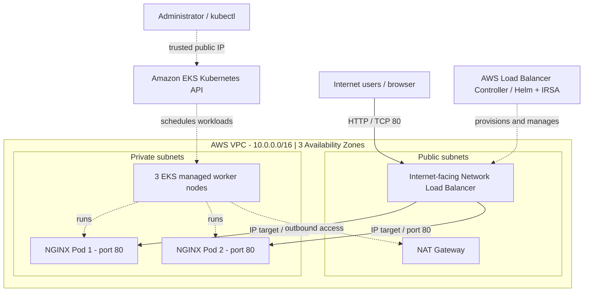
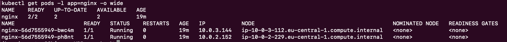
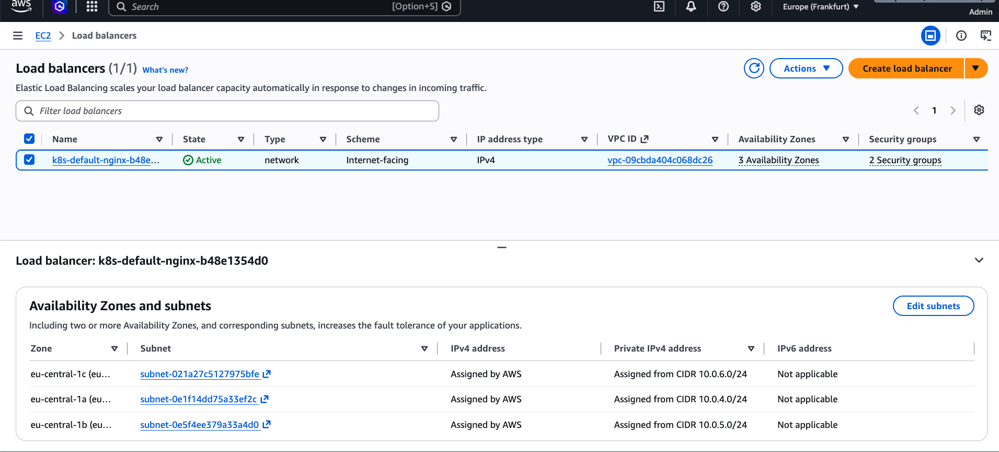
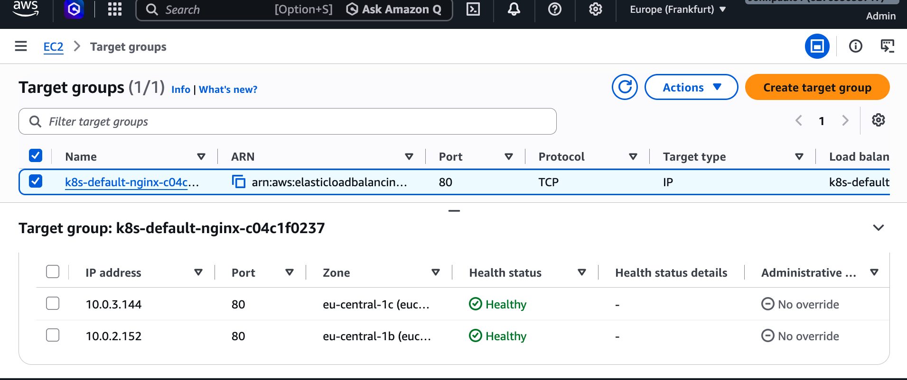

# AWS EKS Infrastructure Automation with Terraform and Kubernetes

**Terraform | Amazon EKS | Kubernetes 1.36 | NGINX | AWS Network Load Balancer | Helm | IAM/IRSA**

## Overview

This project demonstrates the end-to-end deployment of a containerized NGINX application on **Amazon Elastic Kubernetes Service (EKS)**. Terraform provisions the AWS networking and Kubernetes infrastructure, while the **AWS Load Balancer Controller** exposes the application through an internet-facing **Network Load Balancer (NLB)** using direct IP targets.

The implementation combines infrastructure automation, private-subnet networking, Kubernetes workload management, IAM-based controller permissions, and deployment verification. It was built and tested as a cloud engineering lab, with a documented teardown process for managing infrastructure costs.

### Key outcomes

- Provisioned an EKS cluster running **Kubernetes 1.36**, with **three managed EC2 worker nodes** across private subnets.
- Configured a VPC with **three public and three private subnets across three Availability Zones**, plus a NAT Gateway for outbound connectivity.
- Restricted the public Kubernetes API endpoint to a trusted administrator IPv4 `/32` CIDR; private endpoint access remained enabled.
- Installed the **AWS Load Balancer Controller v3.6.2** with Helm and configured AWS permissions using a dedicated IAM role and Kubernetes ServiceAccount (**IRSA**).
- Deployed **two NGINX replicas**, with readiness/liveness probes and CPU/memory requests and limits.
- Validated an **active, internet-facing NLB** using **IP target mode**, with both NGINX Pod IPs registered as **healthy targets** in different Availability Zones.
- Confirmed public HTTP access to the NGINX welcome page through the NLB DNS endpoint.

---

## Architecture



### Request flow

1. A visitor sends an HTTP request to the public NLB hostname on port `80`.
2. The **AWS Load Balancer Controller** manages the NLB in response to the Kubernetes `Service` definition.
3. The NLB forwards TCP traffic directly to a **healthy NGINX Pod IP** on port `80`.
4. NGINX serves the requested content. The Kubernetes Service selects the application Pods using the label `app: nginx`.

The worker nodes and Pods run in private subnets. The NAT Gateway supports **outbound** access from private resources and is not part of the incoming application traffic path. The public NLB is separate from the Kubernetes management API.

---

## Technology Stack

| Component | Implementation |
|---|---|
| Cloud platform | AWS, region `eu-central-1` (Frankfurt) |
| Infrastructure as Code | Terraform; AWS provider `~> 6.0` |
| Terraform modules | EKS `21.29.0`, VPC `6.7.3` |
| Kubernetes | Amazon EKS, Kubernetes `1.36` |
| Compute | EKS managed node group, three EC2 worker nodes, Amazon Linux 2023 |
| Networking | VPC, public/private subnets, routes, NAT Gateway |
| Application | NGINX container image `nginx:1.30.6` |
| Workload management | Kubernetes Deployment with two replicas and health probes |
| External access | AWS Network Load Balancer, internet-facing, IP target mode |
| Controller | AWS Load Balancer Controller `v3.6.2`, installed using Helm |
| Identity and authorization | IAM policy, IAM role, Kubernetes ServiceAccount, IRSA (`eksctl`) |
| Verification | Terraform CLI, `kubectl`, AWS CLI, browser and AWS Console |

### Infrastructure configuration

| Setting | Value |
|---|---|
| EKS cluster | `myapp-eks-cluster` |
| AWS region | `eu-central-1` |
| VPC CIDR | `10.0.0.0/16` |
| Private subnets | `10.0.1.0/24`, `10.0.2.0/24`, `10.0.3.0/24` |
| Public subnets | `10.0.4.0/24`, `10.0.5.0/24`, `10.0.6.0/24` |
| Managed node group | `dev`, desired size `3` |
| Core EKS add-ons | CoreDNS, kube-proxy, VPC CNI, EKS Pod Identity Agent |
| EKS public API access | Enabled, restricted through `my_public_ip_cidr` |
| EKS private API access | Enabled by the Terraform EKS module default |
| NLB listener / target port | TCP `80` / `80` |

The EC2 instance size is controlled by `instance_types` in `eks-cluster.tf` and should be selected with sufficient capacity for the Kubernetes add-ons and controller.

### NGINX workload configuration

| Setting | Value |
|---|---|
| Replicas | `2` |
| Readiness probe | HTTP `GET /` on port `80` |
| Liveness probe | HTTP `GET /` on port `80` |
| CPU request / limit per Pod | `25m` / `200m` |
| Memory request / limit per Pod | `32Mi` / `128Mi` |
| Service type | `LoadBalancer` |
| Load balancer class | `service.k8s.aws/nlb` |
| NLB scheme | `internet-facing` |
| NLB target type | `ip` |

---

## Repository Structure

```text
terraform-aws-eks-kubernetes-nginx/
├── eks-cluster.tf
├── vpc.tf
├── providers.tf
├── variable.tf
├── nginx-config.yaml
├── terraform.tfvars.example
├── .terraform.lock.hcl
├── .gitignore
├── pictures/
│   ├── aws-network-load-balancer.png
│   ├── nginx-healthy-targets.png
│   ├── nginx-two-pods.png
│   └── nginx-welcome.png
└── README.md
```

`eks-cluster.tf` defines the EKS cluster and worker nodes; `vpc.tf` provisions networking; `variable.tf` declares the trusted API access CIDR; and `nginx-config.yaml` defines the NGINX Deployment and NLB-backed Service. The `pictures/` directory contains deployment evidence.

The repository includes `terraform.tfvars.example` as a template. The actual `terraform.tfvars`, Terraform state, and AWS credentials must remain outside version control.

---

## Deployment Guide

### Prerequisites

- AWS account with permissions to manage EKS, EC2/VPC, IAM, and Elastic Load Balancing.
- Terraform, AWS CLI, `kubectl`, Helm, `eksctl`, and Git installed locally.
- A trusted public IPv4 address to restrict access to the EKS Kubernetes API.
- Awareness that EKS, EC2, NAT Gateway, NLB and public IPv4 resources incur AWS charges while provisioned.

### 1. Provision the AWS infrastructure

```bash
git clone https://github.com/Johnpaul790/terraform-aws-eks-kubernetes-nginx.git
cd terraform-aws-eks-kubernetes-nginx

cp terraform.tfvars.example terraform.tfvars
curl -4 https://checkip.amazonaws.com
```

In your local `terraform.tfvars`, replace `YOUR_PUBLIC_IP/32` with your current public IPv4 address followed by `/32`. Review the subnet settings, AWS account, and instance size before applying.

```bash
terraform init
terraform fmt -check -recursive
terraform validate
terraform plan
terraform apply
```

### 2. Connect to EKS

```bash
aws eks update-kubeconfig \
  --region eu-central-1 \
  --name myapp-eks-cluster

kubectl get nodes
kubectl get pods -n kube-system
```

### 3. Configure IAM permissions for the AWS Load Balancer Controller

Download the IAM policy for the controller version used in this project:

```bash
curl -fsSL -o iam_policy.json \
  https://raw.githubusercontent.com/kubernetes-sigs/aws-load-balancer-controller/v3.6.2/docs/install/iam_policy.json
```

Create the account-level policy **once**, if it does not already exist:

```bash
aws iam create-policy \
  --policy-name AWSLoadBalancerControllerIAMPolicy \
  --policy-document file://iam_policy.json
```

Retrieve the policy ARN and configure the controller ServiceAccount with a dedicated IAM role:

```bash
POLICY_ARN=$(aws iam list-policies \
  --scope Local \
  --query "Policies[?PolicyName=='AWSLoadBalancerControllerIAMPolicy'].Arn | [0]" \
  --output text)

eksctl create iamserviceaccount \
  --cluster myapp-eks-cluster \
  --region eu-central-1 \
  --namespace kube-system \
  --name aws-load-balancer-controller \
  --role-name AmazonEKSLoadBalancerControllerRole \
  --attach-policy-arn "$POLICY_ARN" \
  --approve
```

This IRSA setup grants the controller the necessary AWS permissions through its own Kubernetes identity, rather than embedding AWS access keys in the application.

### 4. Install the controller with Helm

```bash
helm repo add eks https://aws.github.io/eks-charts
helm repo update

VPC_ID=$(aws eks describe-cluster \
  --region eu-central-1 \
  --name myapp-eks-cluster \
  --query 'cluster.resourcesVpcConfig.vpcId' \
  --output text)

helm install aws-load-balancer-controller \
  eks/aws-load-balancer-controller \
  --namespace kube-system \
  --version 3.6.2 \
  --set clusterName=myapp-eks-cluster \
  --set region=eu-central-1 \
  --set vpcId="$VPC_ID" \
  --set serviceAccount.create=false \
  --set serviceAccount.name=aws-load-balancer-controller

kubectl rollout status deployment/aws-load-balancer-controller \
  -n kube-system --timeout=180s
```

### 5. Deploy NGINX and verify external access

```bash
kubectl apply -f nginx-config.yaml
kubectl rollout status deployment/nginx --timeout=180s
kubectl get deployment nginx
kubectl get pods -l app=nginx -o wide
kubectl get svc nginx
```

After AWS provisions the load balancer, open the NLB DNS hostname using `http://<NLB_DNS_NAME>/`. The demo uses HTTP on port `80`; HTTPS/TLS is not configured.

To verify the AWS load balancer type and state:

```bash
aws elbv2 describe-load-balancers \
  --region eu-central-1 \
  --query "LoadBalancers[?contains(DNSName, 'k8s-default-nginx')].[LoadBalancerName,Type,Scheme,State.Code]" \
  --output table
```

Use the AWS EC2 Console under **Target Groups** to confirm that the NLB target group uses the `IP` target type and that both NGINX Pod targets report `Healthy`.

---

## Deployment Verification

The following outcomes were observed during the tested deployment. The evidence documents a successful lab run rather than continuous production availability.

| Verification | Observed result |
|---|---|
| EKS worker nodes | **3/3 Ready**, Kubernetes `v1.36.5-eks-577a51e` |
| Core system components | CoreDNS, VPC CNI, kube-proxy and Pod Identity Agent running |
| AWS Load Balancer Controller | **2/2 available**; ServiceAccount IAM role annotation confirmed |
| NGINX Deployment | **2/2 ready**, both Pods `Running`, zero restarts at verification |
| Pod placement | Two worker nodes across **two Availability Zones** |
| AWS NLB | Type `network`, scheme `internet-facing`, state `active` |
| NLB target group | Type `IP`, TCP port `80`, **2/2 targets Healthy** |
| Public endpoint | NGINX welcome page successfully served over HTTP |

### Deployment Evidence

**NGINX application: two running replicas on different worker nodes**



**AWS Network Load Balancer: active, internet-facing and configured across three Availability Zones**



**NLB target group: both NGINX Pod IPs registered as healthy targets**



**Public application: NGINX welcome page reached through the NLB DNS name**


The load balancer hostname is ephemeral. Screenshots preserve the verified deployment results after infrastructure teardown.

---

## Design Decisions and Scope

- **Restricted administration:** The EKS public API endpoint accepts connections only from the trusted administrator CIDR; AWS and Kubernetes authentication/authorization are still required.
- **Private compute:** Worker nodes and application Pods run inside private subnets; the internet-facing NLB provides the public application entry point.
- **Direct Pod targets:** NLB IP target mode registers the private IP addresses of the selected NGINX Pods.
- **Basic workload resilience:** Two replicas, readiness/liveness probes and resource settings improve application behavior. The observed cross-node/AZ Pod distribution is not enforced by an explicit topology spread rule.
- **Cost-conscious networking:** A single NAT Gateway reduces lab cost but is not a multi-AZ high-availability NAT design.
- **Non-production scope:** HTTPS/TLS, centralized monitoring, autoscaling and automated delivery are appropriate next steps for a production implementation but are intentionally outside this lab's scope.

---

## Infrastructure Cleanup

The project is designed for repeatable deployment and teardown. Delete the Kubernetes-managed NLB before removing the EKS control plane so the controller can clean up AWS load-balancing resources.

**1. Remove the application and its Service:**

```bash
kubectl delete -f nginx-config.yaml
kubectl get svc nginx
```

The Service should eventually return `NotFound`. Confirm that the associated NLB and target group have been deleted in the AWS Console or using `aws elbv2 describe-load-balancers`.

**2. Remove the controller and its IAM ServiceAccount/role:**

```bash
helm uninstall aws-load-balancer-controller -n kube-system

eksctl delete iamserviceaccount \
  --cluster myapp-eks-cluster \
  --region eu-central-1 \
  --namespace kube-system \
  --name aws-load-balancer-controller
```

**3. Destroy the Terraform-managed AWS infrastructure:**

```bash
terraform plan -destroy
terraform destroy
terraform state list
```

Review the destruction plan before approving. Verify that the project-managed EKS cluster, compute instances, NAT Gateway and networking resources have been removed. The controller IAM policy was created outside Terraform and can be retained for future labs or managed separately.

---

## References

- [Amazon EKS](https://docs.aws.amazon.com/eks/)
- [AWS Load Balancer Controller](https://kubernetes-sigs.github.io/aws-load-balancer-controller/)
- [Terraform AWS EKS module](https://github.com/terraform-aws-modules/terraform-aws-eks)
- [Terraform AWS VPC module](https://github.com/terraform-aws-modules/terraform-aws-vpc)
- [Terraform documentation](https://developer.hashicorp.com/terraform)
- [Kubernetes Deployments](https://kubernetes.io/docs/concepts/workloads/controllers/deployment/)
- [Kubernetes Services](https://kubernetes.io/docs/concepts/services-networking/service/)
