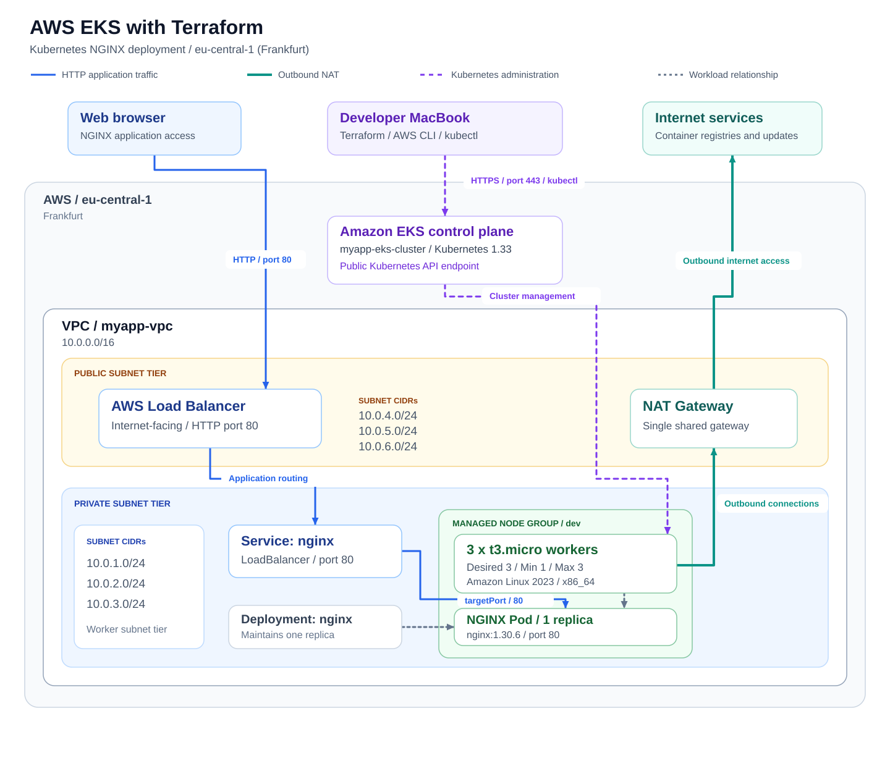

# AWS EKS with Terraform — Kubernetes NGINX Deployment

## Project Overview

A Cloud/DevOps portfolio project that provisions AWS networking and an Amazon EKS cluster with Terraform, then deploys NGINX using a Kubernetes Deployment and an internet-facing `LoadBalancer` Service in Frankfurt (`eu-central-1`).

The completed lab test confirmed three ready worker nodes, a running NGINX Pod, a successful Deployment rollout, and external browser access to the standard **"Welcome to nginx!"** page over HTTP. This personal home lab was built to practice infrastructure provisioning, Kubernetes operations, troubleshooting, and cleanup. It is not a production environment.

## Key Achievements

- Provisioned the VPC and EKS infrastructure using Terraform and pinned AWS module versions.
- Configured public and private subnet tiers, Kubernetes subnet discovery tags, and a single NAT Gateway for outbound connectivity.
- Configured an EKS managed node group in private subnets; all three workers reported `Ready` during testing.
- Deployed one NGINX replica and exposed it through a Kubernetes `LoadBalancer` Service on port `80`.
- Verified Pod readiness, zero restarts at the time of inspection, and a successful Deployment rollout.
- Confirmed external HTTP access through the AWS load balancer and resolved an initial HTTPS connection attempt by using the configured HTTP endpoint.

## Architecture Diagram



[View the full-size SVG diagram](architecture.svg) · [Editable Mermaid version](architecture.mmd)

**Traffic paths:** Blue arrows show inbound HTTP application traffic; thick teal arrows show outbound connectivity through NAT. Dashed purple arrows show Kubernetes administration, and dashed gray arrows show workload relationships. The Service box represents logical Kubernetes routing to the selected Pod. The NAT Gateway is separate from the inbound HTTP request path.

The diagram includes the subnet CIDRs from [`terraform.tfvars.example`](terraform.tfvars.example), the EKS cluster and managed node group, and the single NGINX Pod. Worker placement across individual subnets is not fixed by this diagram.

Terraform provisions the VPC and EKS infrastructure. Applying the Kubernetes manifest requests AWS load balancing through the Service. The manifest leaves the load balancer class and type-specific annotations unspecified, so the diagram uses a generic AWS load balancer label. See [AWS EKS load balancing guidance](https://docs.aws.amazon.com/eks/latest/userguide/network-load-balancing.html) for controller behavior.

## Technology Stack

| Technology | Repository version or configuration |
| --- | --- |
| Terraform | Root configuration does not pin the CLI; the [EKS module requires `>= 1.5.7`](https://github.com/terraform-aws-modules/terraform-aws-eks/blob/v21.29.0/versions.tf) |
| AWS provider | `hashicorp/aws`; constraint `~> 6.0`; locked version `6.68.0` |
| Terraform EKS module | `terraform-aws-modules/eks/aws` — `21.29.0` |
| Terraform VPC module | `terraform-aws-modules/vpc/aws` — `6.7.3` |
| AWS / Amazon EKS | Region `eu-central-1`; managed cluster `myapp-eks-cluster` |
| Kubernetes | Version `1.33`; Deployment and `LoadBalancer` Service |
| Amazon EC2 | Managed node group `dev`; `t3.micro` worker instances |
| Worker operating system | `AL2023_x86_64_STANDARD` — standard Amazon Linux 2023 x86_64 |
| Amazon VPC | Public and private subnet tiers; single NAT Gateway |
| NGINX | Container image `nginx:1.30.6`; one replica |
| YAML | `nginx-config.yaml`; `apps/v1` Deployment and `v1` Service manifests |

Versions and settings come from the Terraform files, `.terraform.lock.hcl`, and `nginx-config.yaml`. The lockfile records provider selections; it does not pin the local AWS CLI or kubectl versions.

## AWS Infrastructure and Networking

The network inputs are defined in [`terraform.tfvars.example`](terraform.tfvars.example) and consumed by [`vpc.tf`](vpc.tf).

| Setting | Configuration |
| --- | --- |
| AWS Region | `eu-central-1` — Frankfurt |
| VPC name | `myapp-vpc` |
| VPC CIDR | `10.0.0.0/16` |
| Private subnet CIDRs | `10.0.1.0/24`, `10.0.2.0/24`, `10.0.3.0/24` |
| Public subnet CIDRs | `10.0.4.0/24`, `10.0.5.0/24`, `10.0.6.0/24` |
| Availability Zones | Discovered using `aws_availability_zones`; zone names are not hardcoded |
| NAT Gateway | Enabled; one shared NAT Gateway (`single_nat_gateway = true`) |
| DNS hostnames | Enabled (`enable_dns_hostnames = true`) |
| Public subnet discovery tag | `kubernetes.io/role/elb = 1` |
| Private subnet discovery tag | `kubernetes.io/role/internal-elb = 1` |
| Cluster association tag | `kubernetes.io/cluster/myapp-eks-cluster = shared` |

**Cluster and compute:** [`eks-cluster.tf`](eks-cluster.tf) configures cluster `myapp-eks-cluster` and managed node group `dev` with three desired workers, a minimum of one, and a maximum of three. Workers use `t3.micro` instances and the standard `AL2023_x86_64_STANDARD` AMI type. Public EKS API access and cluster creator administrator access are enabled.

**Private worker placement:** The node group uses the VPC's private subnets, keeping workers behind the public application entry point. The public load balancer provides inbound application access, while the [NAT Gateway](https://docs.aws.amazon.com/vpc/latest/userguide/vpc-nat-gateway.html) supports outbound connections such as container image pulls.

**Cluster add-ons:** CoreDNS, kube-proxy, VPC CNI, and EKS Pod Identity Agent are configured without explicit add-on version pins. VPC CNI (`vpc-cni`) and EKS Pod Identity Agent (`eks-pod-identity-agent`) use `before_compute = true` to establish their module dependencies before worker compute is created.

**Application exposure:** [`nginx-config.yaml`](nginx-config.yaml) defines Deployment `nginx` with one replica and Service `nginx` with type `LoadBalancer`. The Service selects `app: nginx` Pods and forwards TCP port `80` to container port `80`, serving HTTP. Application TLS is not configured.

## Project Structure

```text
terraform-aws-eks-kubernetes-nginx/
├── .gitignore                 # Local Terraform files and private variables
├── .terraform.lock.hcl        # Provider versions and checksums
├── README.md
├── architecture.mmd          # Editable Mermaid architecture diagram
├── architecture.svg          # Architecture image displayed in this README
├── eks-cluster.tf             # EKS cluster, add-ons, and managed node group
├── nginx-config.yaml          # NGINX Deployment and LoadBalancer Service
├── pictures/
│   └── nginx-welcome.png      # NGINX browser verification screenshot
├── providers.tf               # AWS provider source and version constraint
├── terraform.tfvars.example   # Example network inputs
└── vpc.tf                     # Region, VPC, subnets, NAT, and discovery tags
```

Terraform state, private `.tfvars` files, downloaded Terraform dependencies, and local editor settings are excluded by `.gitignore`.

## Prerequisites

- **Terraform `1.5.7` or later**, satisfying the pinned EKS module's minimum requirement.
- **AWS CLI v2** with valid credentials for the intended AWS account and profile.
- **kubectl** compatible with Kubernetes `1.33`. AWS supports the same minor version or one minor version earlier or later; see [EKS kubeconfig prerequisites](https://docs.aws.amazon.com/eks/latest/userguide/create-kubeconfig.html).
- **IAM permissions** to provision and delete EKS, EC2/VPC, IAM roles and policies (including passing roles), and the modules' dependent resources. Elastic Load Balancing read permissions are needed for the cleanup inspection commands.
- **Git** for cloning the repository.

**AWS charges apply:** EKS, EC2 workers, NAT Gateways, load balancers, storage, public IPv4 addresses, and data transfer can incur charges. Use the [cleanup procedure](#infrastructure-cleanup) when finished.

## Deployment Instructions

Run commands from a local terminal, checking each result before proceeding. Terraform provisions infrastructure; kubectl deploys the application afterward.

1. **Clone the repository.**

   ```bash
   git clone https://github.com/Johnpaul790/terraform-aws-eks-kubernetes-nginx.git
   cd terraform-aws-eks-kubernetes-nginx
   ```

2. **Create the local Terraform input file.**

   ```bash
   cp terraform.tfvars.example terraform.tfvars
   ```

   Review the network inputs in [`terraform.tfvars.example`](terraform.tfvars.example) and adjust the local copy if needed. The local `.tfvars` file is ignored by Git.

3. **Configure AWS credentials and verify the identity.**

   Configure the AWS CLI locally with `aws configure` or your existing SSO/profile setup. If using a named profile, select it with `export AWS_PROFILE=your-profile-name`, then verify:

   ```bash
   aws sts get-caller-identity
   ```

   Confirm the intended AWS account and IAM identity. Use the cluster creator identity for the later kubectl steps, or another identity explicitly granted cluster access.

4. **Initialize Terraform.**

   ```bash
   terraform init
   ```

5. **Check formatting and validate the configuration.**

   ```bash
   terraform fmt -check -recursive
   terraform validate
   ```

   If formatting differences are reported, run `terraform fmt -recursive`, review the diff, and repeat the check. [Terraform validation](https://developer.hashicorp.com/terraform/cli/commands/validate) checks configuration syntax and internal consistency; AWS permissions, quotas, and runtime provisioning constraints still need to be satisfied.

6. **Review the infrastructure plan and apply it.**

   ```bash
   terraform plan
   terraform apply
   ```

   Review the proposed resources and the apply confirmation before approving creation. Provisioning the cluster and registering workers can take several minutes.

7. **Configure Kubernetes access and select the application namespace.**

   ```bash
   aws eks update-kubeconfig --region eu-central-1 --name myapp-eks-cluster
   kubectl config current-context
   kubectl config set-context --current --namespace=default
   ```

   Confirm that the context identifies `myapp-eks-cluster`. The remaining unqualified application commands use the `default` namespace selected here.

8. **Verify worker readiness.**

   ```bash
   kubectl get nodes
   ```

   Wait for all three workers to report `Ready` for a fresh deployment using this configuration.

9. **Deploy NGINX.**

   ```bash
   kubectl apply -f nginx-config.yaml
   ```

10. **Verify the Deployment, Pod, and Service.**

    ```bash
    kubectl get pods -o wide
    kubectl get svc nginx
    kubectl rollout status -n default deployment/nginx --timeout=60s
    ```

    Confirm one NGINX Pod with `READY` equal to `1/1`, status `Running`, and a successful rollout. The Service may initially show `<pending>` while AWS provisions the load balancer.

11. **Retrieve the AWS load balancer DNS hostname.**

    ```bash
    kubectl get svc nginx -o jsonpath='{.status.loadBalancer.ingress[0].hostname}{"\n"}'
    ```

    Wait for a nonempty hostname; use `kubectl get svc nginx -w` to watch provisioning, then stop watching with `Ctrl+C`. The hostname is temporary and may change when the Service or load balancer is recreated. Retrieve it for each deployment.

12. **Access the NGINX welcome page over HTTP.**

    After the Service has a hostname:

    ```bash
    NGINX_LB_HOSTNAME=$(kubectl get svc nginx -o jsonpath='{.status.loadBalancer.ingress[0].hostname}')
    printf 'Open in your browser: http://%s\n' "$NGINX_LB_HOSTNAME"
    curl --fail --show-error --connect-timeout 10 --max-time 30 "http://${NGINX_LB_HOSTNAME}"
    ```

    Open the printed URL using **`http://` on port `80`**. Using `https://` will not reach a configured TLS listener in this lab. Allow additional time for DNS propagation and backend health checks after the hostname appears.

## Deployment Verification and Screenshots

The following results were observed during the completed lab test:

| Verification | Observed result |
| --- | --- |
| EKS workers | Three worker nodes reported `Ready` |
| NGINX Pod | `READY: 1/1`, `STATUS: Running` |
| Container restarts | `0` at the time of inspection |
| LoadBalancer Service | Service `nginx` received an AWS ELB DNS hostname |
| Deployment rollout | `kubectl rollout status deployment/nginx --timeout=60s` returned `deployment "nginx" successfully rolled out` |
| External browser access | Initial HTTPS attempt was unsuccessful; HTTP on port `80` displayed **"Welcome to nginx!"** |

The screenshot below captures the successful browser result. It omits the browser address bar and the temporary load balancer hostname. The test results describe the completed lab session; retrieve the current hostname and repeat the checks for a new deployment.


## Troubleshooting

| Symptom | Checks and next steps |
| --- | --- |
| NGINX URL does not load | Retrieve the hostname from `kubectl get svc nginx` and test it with the HTTP command above. Check the Pod, Service endpoints, and AWS backend health. |
| HTTPS connection fails | Use `http://` on port `80`. This manifest configures HTTP; it has no TLS listener or certificate. |
| Service hostname remains `<pending>` | Run `kubectl describe svc nginx` and `kubectl get events --sort-by=.metadata.creationTimestamp`. Check provisioning events, subnet discovery tags, permissions, and AWS quotas. |
| Hostname exists but traffic still fails | Allow time for DNS propagation and load balancer health checks. Inspect the port `80` listener, backend health, relevant security group rules, and subnet routes in AWS. |
| An older URL has stopped working | Retrieve the current Service hostname again. Recreating the Service or load balancer can invalidate a previously recorded DNS name. |
| Pod is `Pending`, not ready, or restarting | Run `kubectl describe pods -l app=nginx` and `kubectl logs deployment/nginx`. Inspect image pulls, events, worker capacity, and outbound connectivity through NAT. |
| Worker nodes are not `Ready` | Run `kubectl describe nodes` and `kubectl get pods -n kube-system`. Inspect node conditions, EKS node group health, networking, and add-on status. |
| Service has no usable backend endpoints | Run `kubectl get endpointslices -l kubernetes.io/service-name=nginx`. Confirm that the Service selector matches `app: nginx`, the Pod is ready, and `targetPort` is `80`. |
| kubectl cannot connect or returns `Unauthorized` | Check `aws sts get-caller-identity`, `kubectl config current-context`, and API reachability. Refresh kubeconfig using the cluster creator identity or another identity with granted access. |
| Terraform destruction reports dependency errors | Confirm the Service and its AWS load balancer have been removed. Wait for dependent network interfaces and security groups to be released before retrying cleanup. |

See the official [Kubernetes Service debugging guide](https://kubernetes.io/docs/tasks/debug/debug-application/debug-service/) for additional endpoint and connectivity checks.

## Architecture Decisions and Limitations

- **Public EKS API access:** Enables remote cluster administration from a local MacBook. Cluster creator administrator access is enabled, and this configuration does not define a public endpoint CIDR allowlist. A production design should review API exposure and administrative scope; see [EKS endpoint access](https://docs.aws.amazon.com/eks/latest/userguide/cluster-endpoint.html).
- **Private worker subnets:** Keep worker placement separate from the internet-facing load balancer, with NAT supporting worker-initiated outbound connectivity.
- **Single NAT Gateway:** Reduces the number of NAT Gateways billed for the lab, while creating a shared dependency and possible cross-AZ traffic costs.
- **Small EC2 workers:** `t3.micro` instances have limited CPU, memory, and Pod capacity. The standard, non-GPU `AL2023_x86_64_STANDARD` AMI matches the configured x86_64 instance architecture.
- **Basic application availability:** NGINX has one replica, with no explicit CPU/memory requests or limits, readiness probes, or liveness probes. Three worker nodes alone do not provide application redundancy.
- **HTTP without application TLS:** Suitable for this non-sensitive demonstration. A production application would need an appropriate HTTPS/TLS design; Kubernetes API administration separately uses HTTPS.
- **Costs and production scope:** AWS resources remain chargeable while provisioned. Production use would require further work on capacity, availability, access controls, observability, state management, and operational automation. Dependency and Kubernetes versions also need review before future deployments.

## Infrastructure Cleanup

Remove Kubernetes-managed resources while the cluster is available, then confirm AWS load balancer deletion before destroying the Terraform infrastructure. See the [AWS EKS deletion guidance](https://docs.aws.amazon.com/eks/latest/userguide/delete-cluster.html).

1. **Confirm the cluster context and record the load balancer hostname.**

   ```bash
   kubectl config current-context
   NGINX_LB_HOSTNAME=$(kubectl get svc -n default nginx -o jsonpath='{.status.loadBalancer.ingress[0].hostname}')
   printf 'Load balancer to verify after deletion: %s\n' "$NGINX_LB_HOSTNAME"
   ```

   Keep this terminal open. If the Service has already been deleted or has no hostname, identify any associated project load balancer in the AWS console before continuing.

2. **Delete the NGINX Kubernetes resources.**

   ```bash
   kubectl delete -n default -f nginx-config.yaml --wait=true --timeout=10m
   kubectl get svc -n default nginx
   ```

   The Service lookup should return `NotFound` after successful deletion. AWS resource removal may still be completing.

3. **Confirm AWS load balancer removal.**

   Using the nonempty hostname recorded in step 1, inspect both AWS load balancer APIs because the manifest does not pin the implementation:

   ```bash
   aws elb describe-load-balancers --region eu-central-1 \
     --query "LoadBalancerDescriptions[?DNSName=='${NGINX_LB_HOSTNAME}'].[LoadBalancerName,DNSName]" \
     --output table

   aws elbv2 describe-load-balancers --region eu-central-1 \
     --query "LoadBalancers[?DNSName=='${NGINX_LB_HOSTNAME}'].[LoadBalancerName,DNSName]" \
     --output table
   ```

   Repeat until both commands succeed and neither returns a matching load balancer, or confirm removal in the AWS EC2 console's **Load Balancers** view. Resolve API or permission errors before treating an empty result as confirmation.

4. **Destroy the Terraform infrastructure.**

   Run this from the project directory and Terraform workspace used for deployment, with its state available:

   ```bash
   terraform destroy
   ```

   Review the destruction plan before approving. Keep the local state until cleanup succeeds so Terraform can track any remaining resources.

5. **Check for billable leftovers.**

   Review Terraform's completion output, then inspect `eu-central-1` for remaining project resources: the EKS cluster and node group, EC2 workers, NAT Gateway, load balancer, Elastic IP addresses, and any retained volumes or network interfaces. Resolve confirmed project leftovers while preserving unrelated resources.

## Planned Improvements

- Add **GitHub Actions** for automated Terraform formatting/validation and Kubernetes manifest validation. CI/CD workflows are not currently implemented in this repository.
- Add resource requests/limits and health probes, then evaluate worker sizing and multiple NGINX replicas.
- Evaluate application HTTPS/TLS, narrower Kubernetes API access, and a shared remote Terraform state backend before expanding the lab.

## Official References

- [AWS: Configure kubectl access to EKS](https://docs.aws.amazon.com/eks/latest/userguide/create-kubeconfig.html)
- [AWS: EKS Kubernetes API endpoint access](https://docs.aws.amazon.com/eks/latest/userguide/cluster-endpoint.html)
- [AWS: EKS load balancing guidance](https://docs.aws.amazon.com/eks/latest/userguide/network-load-balancing.html)
- [AWS: NAT Gateways](https://docs.aws.amazon.com/vpc/latest/userguide/vpc-nat-gateway.html)
- [AWS: Delete an EKS cluster and associated resources](https://docs.aws.amazon.com/eks/latest/userguide/delete-cluster.html)
- [HashiCorp: Terraform validation](https://developer.hashicorp.com/terraform/cli/commands/validate)
- [Terraform AWS EKS module — v21.29.0](https://github.com/terraform-aws-modules/terraform-aws-eks/blob/v21.29.0/README.md)
- [Terraform AWS VPC module — v6.7.3](https://github.com/terraform-aws-modules/terraform-aws-vpc/blob/v6.7.3/README.md)
- [Kubernetes: Deployments](https://kubernetes.io/docs/concepts/workloads/controllers/deployment/)
- [Kubernetes: Services](https://kubernetes.io/docs/concepts/services-networking/service/)
- [Kubernetes: Debug Services](https://kubernetes.io/docs/tasks/debug/debug-application/debug-service/)
