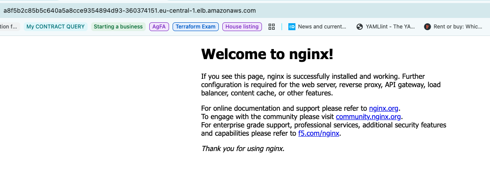

# Amazon EKS with Terraform and NGINX

A DevOps portfolio project demonstrating AWS infrastructure provisioning with Terraform and application deployment on Kubernetes. Terraform creates the VPC and Amazon EKS cluster; a Kubernetes manifest deploys NGINX and exposes it through an AWS load balancer.

## Architecture

```text
Internet → AWS load balancer → Kubernetes Service (port 80) → NGINX Pod
```

- **Networking:** Public and private subnets, load balancer discovery tags, and a single NAT gateway for outbound access from private subnets.
- **Cluster:** `myapp-eks-cluster`, Kubernetes `1.33`, in `eu-central-1` (Frankfurt).
- **Compute:** The `dev` managed node group runs in private subnets using Amazon Linux 2023 x86_64 and `t3.micro` instances. Desired size: 3 nodes; minimum: 1; maximum: 3.
- **Add-ons:** CoreDNS, kube-proxy, VPC CNI, and EKS Pod Identity Agent.
- **Application:** One `nginx:1.30.6` replica and a `LoadBalancer` Service forwarding HTTP traffic to container port 80.

This is a development demo with public EKS API access, a single NAT gateway, and one application replica. AWS resources incur charges.

## Repository layout

| File | Purpose |
| --- | --- |
| [`providers.tf`](providers.tf) | AWS provider and region |
| [`vpc.tf`](vpc.tf) | VPC, subnets, NAT gateway, and subnet tags |
| [`eks-cluster.tf`](eks-cluster.tf) | EKS cluster, add-ons, node group, and cluster creator admin access |
| [`nginx-config.yaml`](nginx-config.yaml) | NGINX Deployment and Service |

## Deploy

Prerequisites: Terraform **1.5.7+**, AWS CLI v2 with credentials authorized to provision VPC, EKS, EC2, and IAM resources, and a `kubectl` version compatible with Kubernetes 1.33.

Create `terraform.tfvars` with the inputs required by `vpc.tf`:

```hcl
vpc_cidr_block             = "10.0.0.0/16"
private_subnet_cidr_blocks = ["10.0.10.0/24", "10.0.20.0/24", "10.0.30.0/24"]
public_subnet_cidr_blocks  = ["10.0.1.0/24", "10.0.2.0/24", "10.0.3.0/24"]
```

`terraform.tfvars` is ignored by Git.

Provision the infrastructure:

```bash
terraform init
terraform validate
terraform plan
terraform apply
```

Using the same AWS IAM identity that created the cluster, [configure kubectl access](https://docs.aws.amazon.com/eks/latest/userguide/create-kubeconfig.html) and deploy the application:

```bash
aws eks update-kubeconfig --region eu-central-1 --name myapp-eks-cluster
kubectl get nodes
kubectl apply -n default -f nginx-config.yaml
kubectl rollout status -n default deployment/nginx
kubectl get pods -n default
kubectl get svc -n default nginx
```

Once the Service's `EXTERNAL-IP` field contains a load balancer hostname, open `http://<hostname>` to view the NGINX welcome page.

Existing deployment screenshot:



## Clean up

Delete the Kubernetes resources while the cluster is still running:

```bash
kubectl delete -n default -f nginx-config.yaml
```

Wait for the associated AWS load balancer to be deleted, then remove the Terraform infrastructure:

```bash
terraform destroy
```
